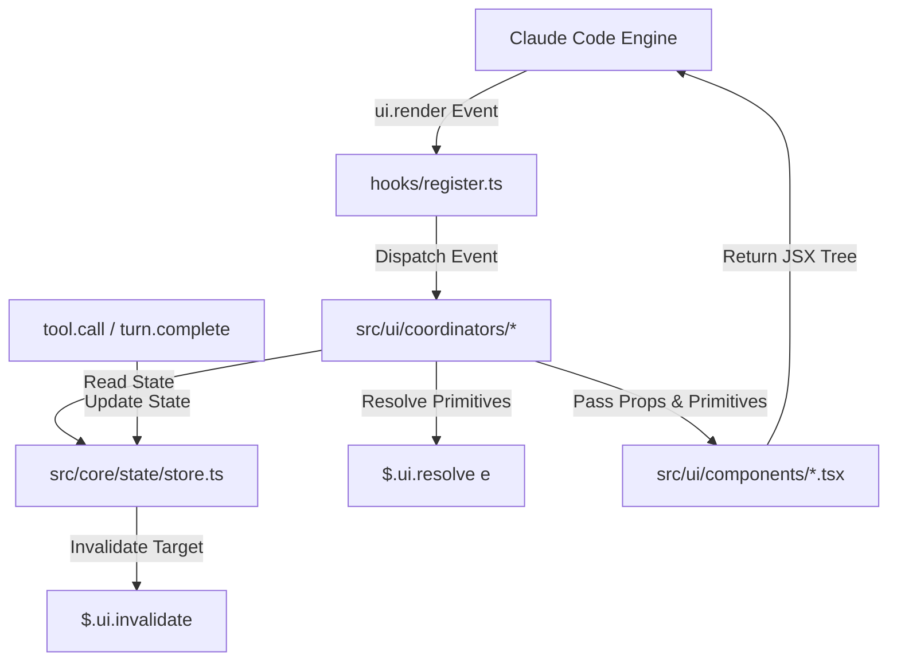

# Production-Grade Claude Code Plugin Architecture & UI Mod Guide

This guide establishes the comprehensive engineering standard, API specifications, and architectural design patterns for building scalable, production-grade **Claude Code Plugins** with in-process **Mods** (functional hooks available from Claude Code v2.1.287+), featuring advanced UI rendering across multiple surfaces.

---

## 1. Architectural Foundations: Plugins, Mods, and Hooks

### 1.1. What Is a Plugin?
In the Claude Code ecosystem, a **Plugin** is a versioned, self-contained distribution bundle that extends engine capabilities. A plugin may contain:
- **Skills** (`skills/<name>/SKILL.md`): Domain knowledge and procedural instructions injected into model context.
- **Slash Commands** (`commands/*.md`): Direct user-facing CLI commands (`/plugin:command`).
- **Custom Subagents** (`agents/*.md`): Specialized background or task agents with isolated context windows.
- **Classic Hooks** (`hooks/hooks.json` -> command/post types): External shell scripts or HTTP webhooks for simple lifecycle triggers.
- **MCP Servers** (`.mcp.json`): Out-of-process servers delivering tools and resources.
- **LSP Servers** (`.lsp.json`): Language server integrations for real-time diagnostics and code intelligence.
- **Mods** (`hooks/hooks.json` -> `"modules": [...]`): In-process ES modules executing directly within the Claude Code runtime engine.

### 1.2. What Is a Mod (Functional Hook)?
Prior to Claude Code v2.1.287, plugins only supported "Classic Hooks" — individual Bash scripts or HTTP webhooks executed on lifecycle events. Classic hooks suffer from process-fork overhead, high latency, zero UI rendering capabilities, and an inability to share in-memory state.

A **Mod** is an in-process TypeScript or JavaScript module executed directly within Claude Code's Node.js runtime:
- Loaded as an ES Module via the exported `register(on, options)` function.
- Intercepts engine middleware via the Mods API (`$`), event payload (`e`), and downstream middleware caller (`next`).
- Directly renders terminal and desktop UI components (`AbovePrompt` status bands, docked `Pane` views, dialogs, status spinners).
- Enforces real-time security boundaries on tool calls (e.g., blocking dangerous Bash commands or file writes).
- Persists shared, reactive state across user turns and plugin reloads.

### 1.3. Architecture Comparison Matrix

| Dimension | Mod (Functional Hook) | Classic Hook | Skill | MCP Server |
| :--- | :--- | :--- | :--- | :--- |
| **Execution Model** | In-process JS/TS async function | Out-of-process Bash/HTTP POST | Markdown instructions | Out-of-process JSON-RPC server |
| **UI Rendering** | Native JSX (`AbovePrompt`, `Pane`, Dialog) | None | None | None |
| **Latency** | Microseconds (in-memory) | Milliseconds to seconds (process fork) | Dependent on LLM turn | Dependent on IPC/RPC transport |
| **Control Scope** | Tools, prompts, turns, UI, session state | Allow/deny tool execution | Steers model reasoning | Provides tools and resources |
| **Best Used For** | Guardrails, rich dashboards, active monitoring | Legacy linters, static CI scripts | Coding styles, repo SOPs | External APIs, databases, git hosts |

---

## 2. Core Architectural Pitfalls and Anti-Patterns

### 2.1. Pitfall 1: Polluting `hooks/` with Domain and UI Logic
A common anti-pattern is treating `hooks/` as the root of all source code:

```text
# ANTI-PATTERN: DO NOT USE
hooks/
├── hooks.json
├── register.ts
├── domains/          # WRONG: Business logic trapped inside hooks adapter
├── ui/               # WRONG: UI components trapped inside hooks adapter
└── shared/
```

**Why this fails:**
- `hooks/` is an integration adapter (infrastructure layer), analogous to `controllers/` in an API service.
- If Custom Commands (`commands/`), Subagents (`agents/`), or background jobs need to share validation logic or UI formatters, they are forced to import across architectural boundaries from `../hooks/domains/...`.
- `claude plugin validate` traverses `hooks/` to inspect hook modules. Placing extensive component trees and domain models inside `hooks/` slows validation and complicates bundling.

**The Solution:**
Keep application logic under `src/` (`src/core/`, `src/ui/`). The `hooks/` directory must contain only `hooks.json` and a thin `register.ts` wire-up entrypoint.

### 2.2. Pitfall 2: Misplacing `marketplace.json` Inside a Plugin
Placing `marketplace.json` inside `.claude-plugin/` of a single plugin is invalid:

```text
# ANTI-PATTERN: DO NOT USE
my-plugin/
├── .claude-plugin/
│   ├── plugin.json
│   └── marketplace.json  # WRONG: Conflates catalog with plugin unit
```

**Why this fails:**
- `.claude-plugin/plugin.json` specifies the metadata for **one single plugin**.
- `marketplace.json` defines a **catalog of multiple plugins** within a repository or organization.
- Storing `marketplace.json` inside a plugin directory violates schema validation under `claude plugin validate --strict` and causes marketplace discovery tools to fail.

**The Solution:**
`marketplace.json` belongs at the root of your marketplace repository, pointing to discrete plugin directories (`./plugins/guard`, `./plugins/dashboard`).

### 2.3. Pitfall 3: Broken TypeScript Types in CI/CD Environments
Relying on ambient declarations or expecting Claude Code to magically generate types during CI is a recipe for broken builds:

```typescript
// FAILS IN CI RUNNERS WITHOUT VENDORING
import 'claude-code'
declare module 'claude-code' { ... }
```

**Why this fails:**
- The `@anthropic-ai/claude-code` npm package only ships CLI binaries and `sdk-tools.d.ts` (tool input schemas). It does **not** expose the `claude-code` engine declarations (`On`, `ModsApi`, `EngineInterface`) at the package root.
- The interactive engine only writes `.claude-plugin/types/claude-code/index.d.ts` when a human launches a local interactive session.
- Headless CI runners (GitHub Actions, GitLab CI) running `npm run typecheck` (`tsc --noEmit`) will immediately throw `TS2307: Cannot find module 'claude-code'`.

**The Solution:**
Vendor the type contract directly into `types/claude-code.d.ts` and configure `tsconfig.json` paths so that `tsc --noEmit` is 100% deterministic and self-contained in any clean CI environment.

---

## 3. UI-First Architecture: Principles and Layout

When a mod renders interactive elements, it operates as a full-fledged terminal application. To maintain sub-10ms render cycles and enable unit testing, code must be decoupled into distinct architectural layers.



### 3.1. Layer Responsibilities

1. **Presentational Components (`src/ui/components/*.tsx`)**:
   - Pure functional components receiving props and UI primitives (`Box`, `Text`, `Button`).
   - Zero access to the global `$` object (`$.ui`, `$.state`, `$.session`).
   - Zero asynchronous side-effects (no network, no file I/O).
   - Fully testable in plain Node.js / Vitest environments without mocking the entire engine.

2. **Render-Site Coordinators (`src/ui/coordinators/*.ts`)**:
   - Acts as Controller / View-Model adapters for specific Claude Code render targets:
     - `AbovePrompt`: Status band pinned directly above the user input prompt.
     - `Pane`: Docked sidebar or floating panel with explicit dimensions and viewport properties.
   - Reads reactive state via `readAtom($, AtomDef)`.
   - Inspects `e.viewport` (`columns`, `rows`) and `e.surface` (`terminal`, `desktop`, `vscode`, `mobile`).
   - Transforms raw domain state into layout props (compact vs. standard vs. expanded).

3. **Reactive State Core (`src/core/state/`)**:
   - Implements the **Versioned Atom Pattern**.
   - Guarantees schema migration when plugins are hot-reloaded (`/reload-plugins`), preventing runtime crashes from stale cache entries.

---

## 4. Production Directory Layout

```text
enterprise-ui-mod/
├── .claude-plugin/
│   └── plugin.json                    # Plugin manifest
├── hooks/
│   ├── hooks.json                     # Points to "../src/register.ts"
│   └── register.ts                    # Root Wire-up Adapter (thin orchestration)
├── src/
│   ├── core/                          # Business logic & state management
│   │   ├── security/
│   │   │   ├── rules.ts               # Command inspection rules
│   │   │   └── scanner.ts             # Security evaluation logic
│   │   └── state/
│   │       ├── atom.ts                # Atom management & migration engine
│   │       └── store.ts               # Concrete state atom definitions
│   ├── ui/                            # Interface systems
│   │   ├── components/                # Pure TSX presentational components
│   │   │   ├── SecurityBanner.tsx     # AbovePrompt component
│   │   │   ├── DashboardPane.tsx      # Pane component
│   │   │   └── primitives.ts          # Common node type definitions
│   │   ├── coordinators/              # Render-site controllers
│   │   │   ├── AbovePromptCoordinator.ts
│   │   │   └── PaneCoordinator.ts
│   │   └── responsive/                # Viewport & surface breakpoint helpers
│   │       └── layout.ts
│   └── utils/
│       └── formatting.ts              # Token and duration formatters
├── types/
│   ├── claude-code.d.ts               # Vendored Type Contract for CI/CD
│   └── index.d.ts                     # Internal domain models
├── tests/
│   ├── core/
│   │   └── scanner.test.ts
│   └── ui/
│       ├── SecurityBanner.test.ts
│       └── PaneCoordinator.test.ts
├── package.json
├── tsconfig.json
└── README.md
```

---

## 5. Concrete Reference Implementation

### 5.1. Manifest and Hook Configuration

#### `.claude-plugin/plugin.json`
```json
{
  "$schema": "https://agent-plugins.org/schemas/1.0.0/plugin.schema.json",
  "name": "enterprise-guard",
  "displayName": "Enterprise Security Guard & Context Dashboard",
  "version": "1.0.0",
  "description": "High-performance security guardrail and multi-surface context monitoring dashboard.",
  "author": {
    "name": "Platform Engineering Team",
    "email": "platform@company.internal"
  },
  "license": "MIT",
  "userConfig": {
    "strict_mode": {
      "type": "boolean",
      "title": "Strict Security Enforcement",
      "description": "Reject destructive bash commands without user confirmation.",
      "default": true
    }
  }
}
```

#### `hooks/hooks.json`
```json
{
  "description": "Module registration for Enterprise Guard",
  "modules": ["../src/register.ts"]
}
```

---

### 5.2. Tooling and TypeScript Configuration

#### `package.json`
```json
{
  "name": "@company/enterprise-guard-mod",
  "version": "1.0.0",
  "type": "module",
  "description": "Production Claude Code security mod with responsive UI",
  "scripts": {
    "typecheck": "tsc --noEmit -p tsconfig.json",
    "test": "claude plugin test ./",
    "validate": "claude plugin validate ./ --strict",
    "check": "npm run typecheck && npm run validate && npm run test"
  },
  "devDependencies": {
    "@anthropic-ai/claude-code": "2.1.319",
    "typescript": "^5.4.5"
  },
  "engines": {
    "node": ">=22.0.0"
  }
}
```

#### `tsconfig.json`
```json
{
  "compilerOptions": {
    "target": "ES2022",
    "module": "NodeNext",
    "moduleResolution": "NodeNext",
    "jsx": "react-jsx",
    "jsxImportSource": "src/ui/components",
    "baseUrl": ".",
    "paths": {
      "claude-code": ["./types/claude-code.d.ts"],
      "claude-code/testing": ["./types/claude-code.d.ts"]
    },
    "strict": true,
    "noImplicitAny": true,
    "strictNullChecks": true,
    "noUncheckedIndexedAccess": true,
    "skipLibCheck": true,
    "forceConsistentCasingInFileNames": true
  },
  "include": ["src/**/*", "hooks/**/*", "types/**/*", "tests/**/*"],
  "exclude": ["node_modules"]
}
```

---

### 5.3. Vendored Type Contract (`types/claude-code.d.ts`)

This file guarantees that `tsc --noEmit` executes successfully in any environment without depending on an active Claude Code installation:

```typescript
declare module 'claude-code' {
  export type SurfaceType = 'terminal' | 'desktop' | 'vscode' | 'mobile'

  export interface ViewportDimensions {
    columns: number
    rows: number
  }

  export interface RenderEventPayload {
    site: 'AbovePrompt' | 'Pane' | 'Notification'
    requestId?: string
    surface: SurfaceType
    viewport: ViewportDimensions
  }

  export interface ToolCallPayload {
    tool: string
    command?: string
    path?: string
    [key: string]: unknown
  }

  export interface UserConfigOptions {
    strict_mode?: boolean
    [key: string]: unknown
  }

  export interface UIPrimitives {
    Box: (props: any) => any
    Text: (props: any) => any
    Button: (props: any) => any
  }

  export interface ModsApi {
    ui: {
      open: (options: { id: string; title: string; placement: string; view?: string }) => void
      close: (id: string) => void
      invalidate: (target: string | { site: string }) => void
      log: (message: string) => void
      toast: (options: { text: string; kind: 'info' | 'warn' | 'error' | 'success' }) => void
      resolve: (e: RenderEventPayload) => UIPrimitives
    }
    state: {
      get: (key: string) => unknown
      set: (key: string, value: unknown) => void
    }
    session: {
      usage: () => {
        context?: { percent: number; usedTokens: number; totalTokens: number }
      }
    }
    command: {
      register: (options: { name: string; description: string }) => Promise<void>
    }
    tool: {
      call: (params: Record<string, unknown>) => Promise<{ deny?: string; result?: unknown }>
    }
  }

  export type HookHandler<TEvent = any, TResult = any> = (
    $: ModsApi,
    e: TEvent,
    next: (e: TEvent) => Promise<TResult>
  ) => Promise<TResult>

  export interface HookRegisterInstance {
    catch: (handler: (err: Error) => any) => HookRegisterInstance
  }

  export interface On {
    (event: 'ui.render', filter: { site: string }, handler: HookHandler<RenderEventPayload, { tree: any }>): HookRegisterInstance
    (event: 'tool.call', filter: { tool: string }, handler: HookHandler<ToolCallPayload, any>): HookRegisterInstance
    (event: 'session.start', handler: HookHandler<any, any>): HookRegisterInstance
    (event: 'command.run', filter: { command: string }, handler: HookHandler<any, any>): HookRegisterInstance
  }
}

declare module 'claude-code/testing' {
  import type { ModsApi, On } from 'claude-code'

  export function describe(name: string, fn: () => void): void
  export function test(name: string, fn: ($: ModsApi, on: On) => Promise<void>): void
  export function expect(actual: any): any
  export function tier(level: string): void
  export const mock: {
    clock: (on: On) => void
  }
}
```

---

### 5.4. Versioned Reactive State Core

#### `src/core/state/atom.ts`
```typescript
import type { ModsApi } from 'claude-code'

export interface AtomDefinition<T> {
  key: string
  version: number
  initial: T
  migrate?: (staleValue: unknown, staleVersion: number) => T
}

interface StoredEnvelope<T> {
  version: number
  data: T
}

export function createAtom<T>(definition: AtomDefinition<T>): AtomDefinition<T> {
  return definition
}

export function readAtom<T>($: ModsApi, atom: AtomDefinition<T>): T {
  const raw = $.state.get(atom.key) as StoredEnvelope<T> | undefined

  if (!raw || typeof raw !== 'object' || !('version' in raw)) {
    const envelope: StoredEnvelope<T> = { version: atom.version, data: atom.initial }
    $.state.set(atom.key, envelope)
    return atom.initial
  }

  if (raw.version !== atom.version) {
    const migratedData = atom.migrate
      ? atom.migrate(raw.data, raw.version)
      : atom.initial

    const envelope: StoredEnvelope<T> = { version: atom.version, data: migratedData }
    $.state.set(atom.key, envelope)
    return migratedData
  }

  return raw.data
}

export function updateAtom<T>($: ModsApi, atom: AtomDefinition<T>, updater: (prev: T) => T): T {
  const current = readAtom($, atom)
  const nextValue = updater(current)
  const envelope: StoredEnvelope<T> = {
    version: atom.version,
    data: nextValue
  }
  $.state.set(atom.key, envelope)
  return nextValue
}
```

#### `src/core/state/store.ts`
```typescript
import { createAtom } from './atom.js'

export interface ViolationRecord {
  id: string
  timestamp: number
  command: string
  reason: string
}

export interface SecurityState {
  blockedCount: number
  violations: ViolationRecord[]
  isPaneOpen: boolean
}

export const SecurityStateAtom = createAtom<SecurityState>({
  key: 'enterprise_guard:state',
  version: 2,
  initial: {
    blockedCount: 0,
    violations: [],
    isPaneOpen: false
  },
  migrate: (staleValue: any, staleVersion: number) => {
    if (staleVersion === 1) {
      return {
        blockedCount: typeof staleValue?.blockedCount === 'number' ? staleValue.blockedCount : 0,
        violations: [],
        isPaneOpen: false
      }
    }
    return {
      blockedCount: 0,
      violations: [],
      isPaneOpen: false
    }
  }
})
```

---

### 5.5. Pure Presentational Components

#### `src/ui/components/SecurityBanner.tsx`
```typescript
export interface SecurityBannerProps {
  blockedCount: number
  contextPercent: number
  isCompact: boolean
  surface: 'terminal' | 'desktop' | 'vscode' | 'mobile'
}

export function SecurityBanner(props: SecurityBannerProps, primitives: any) {
  const { Box, Text } = primitives

  if (props.isCompact || props.surface === 'mobile') {
    return Box({
      flexDirection: 'row',
      children: [
        Text({ weight: 'bold', color: 'cyan', children: ['[GUARD] '] }),
        Text({ children: [`Ctx: ${props.contextPercent.toFixed(0)}% `] }),
        Text({
          color: props.blockedCount > 0 ? 'red' : 'gray',
          children: [`| Blk: ${props.blockedCount}`]
        })
      ]
    })
  }

  return Box({
    borderStyle: 'single',
    borderColor: props.blockedCount > 0 ? 'red' : 'gray',
    paddingLeft: 1,
    paddingRight: 1,
    flexDirection: 'row',
    justifyContent: 'space-between',
    children: [
      Text({ weight: 'bold', color: 'cyan', children: ['ENTERPRISE GUARD: ACTIVE'] }),
      Text({ children: [`Context Window: ${props.contextPercent.toFixed(1)}%`] }),
      Text({
        weight: props.blockedCount > 0 ? 'bold' : 'normal',
        color: props.blockedCount > 0 ? 'red' : 'green',
        children: [`Blocked Violations: ${props.blockedCount}`]
      })
    ]
  })
}
```

#### `src/ui/components/DashboardPane.tsx`
```typescript
import type { ViolationRecord } from '../../core/state/store.js'

export interface DashboardPaneProps {
  blockedCount: number
  contextPercent: number
  violations: ViolationRecord[]
  surface: string
  onClose: () => void
}

export function DashboardPane(props: DashboardPaneProps, primitives: any) {
  const { Box, Text, Button } = primitives

  const violationNodes = props.violations.slice(-3).map((v) =>
    Text({
      key: v.id,
      color: 'yellow',
      children: [`- [${new Date(v.timestamp).toLocaleTimeString()}] ${v.command.slice(0, 30)}...: ${v.reason}\n`]
    })
  )

  return Box({
    borderStyle: 'round',
    borderColor: 'cyan',
    padding: 1,
    flexDirection: 'column',
    children: [
      Text({ weight: 'bold', color: 'cyan', children: ['=== ENTERPRISE SECURITY DASHBOARD ===\n\n'] }),
      Text({ children: [`Surface: ${props.surface.toUpperCase()}\n`] }),
      Text({ children: [`Context Usage: ${props.contextPercent.toFixed(1)}%\n`] }),
      Text({
        color: props.blockedCount > 0 ? 'red' : 'green',
        children: [`Total Intercepted Commands: ${props.blockedCount}\n\n`]
      }),
      Text({ weight: 'bold', children: ['Recent Security Events:\n'] }),
      ...(violationNodes.length > 0 ? violationNodes : [Text({ color: 'gray', children: ['No violations recorded.\n'] })]),
      Text({ children: ['\n'] }),
      Button({
        label: 'Close Dashboard',
        variant: 'secondary',
        onPress: props.onClose
      })
    ]
  })
}
```

---

### 5.6. Render-Site Coordinators

#### `src/ui/coordinators/AbovePromptCoordinator.ts`
```typescript
import type { ModsApi, RenderEventPayload } from 'claude-code'
import { readAtom } from '../../core/state/atom.js'
import { SecurityStateAtom } from '../../core/state/store.js'
import { SecurityBanner } from '../components/SecurityBanner.js'

export async function renderAbovePromptCoordinator($: ModsApi, e: RenderEventPayload) {
  const primitives = $.ui.resolve(e)
  const state = readAtom($, SecurityStateAtom)
  const usage = $.session.usage()
  const contextPercent = usage?.context?.percent || 0

  const isCompact = e.viewport.columns < 80

  const tree = SecurityBanner(
    {
      blockedCount: state.blockedCount,
      contextPercent,
      isCompact,
      surface: e.surface
    },
    primitives
  )

  return { tree }
}
```

#### `src/ui/coordinators/PaneCoordinator.ts`
```typescript
import type { ModsApi, RenderEventPayload } from 'claude-code'
import { readAtom, updateAtom } from '../../core/state/atom.js'
import { SecurityStateAtom } from '../../core/state/store.js'
import { DashboardPane } from '../components/DashboardPane.js'

export const PANE_REQUEST_ID = 'enterprise-guard-monitor-pane'

export async function renderPaneCoordinator($: ModsApi, e: RenderEventPayload) {
  if (e.requestId !== PANE_REQUEST_ID) {
    return { tree: null }
  }

  const primitives = $.ui.resolve(e)
  const state = readAtom($, SecurityStateAtom)
  const usage = $.session.usage()
  const contextPercent = usage?.context?.percent || 0

  const handleClose = () => {
    $.ui.close(PANE_REQUEST_ID)
    updateAtom($, SecurityStateAtom, (prev) => ({ ...prev, isPaneOpen: false }))
  }

  const tree = DashboardPane(
    {
      blockedCount: state.blockedCount,
      contextPercent,
      violations: state.violations,
      surface: e.surface,
      onClose: handleClose
    },
    primitives
  )

  return { tree }
}
```

---

### 5.7. Thin Root Wire-Up Adapter (`hooks/register.ts`)

```typescript
import type { On, UserConfigOptions } from 'claude-code'
import { updateAtom, readAtom } from '../src/core/state/atom.js'
import { SecurityStateAtom } from '../src/core/state/store.js'
import { evaluateBashSecurity } from '../src/core/security/rules.js'
import { renderAbovePromptCoordinator } from '../src/ui/coordinators/AbovePromptCoordinator.js'
import { renderPaneCoordinator, PANE_REQUEST_ID } from '../src/ui/coordinators/PaneCoordinator.js'

export function register(on: On, options: UserConfigOptions) {
  const isStrictMode = options.strict_mode !== false

  // 1. Register Slash Command
  on('session.start', async ($, e, next) => {
    await $.command.register({
      name: 'guard-panel',
      description: 'Open Enterprise Security & Context Dashboard'
    })
    return next(e)
  })

  // 2. Command Trigger
  on('command.run', { command: 'guard-panel' }, async ($) => {
    const state = readAtom($, SecurityStateAtom)
    if (state.isPaneOpen) {
      $.ui.close(PANE_REQUEST_ID)
      updateAtom($, SecurityStateAtom, (prev) => ({ ...prev, isPaneOpen: false }))
      return { text: 'Dashboard pane closed.' }
    } else {
      $.ui.open({
        id: PANE_REQUEST_ID,
        title: 'Enterprise Guard Dashboard',
        placement: 'dock',
        view: 'default'
      })
      updateAtom($, SecurityStateAtom, (prev) => ({ ...prev, isPaneOpen: true }))
      return { text: 'Dashboard pane opened.' }
    }
  })

  // 3. AbovePrompt Render Hook
  on('ui.render', { site: 'AbovePrompt' }, async ($, e) => {
    return renderAbovePromptCoordinator($, e)
  })

  // 4. Pane Render Hook
  on('ui.render', { site: 'Pane' }, async ($, e) => {
    return renderPaneCoordinator($, e)
  })

  // 5. Tool Call Security Guardrail
  on('tool.call', { tool: 'Bash' }, async ($, e, next) => {
    const command = e.command || ''
    const assessment = evaluateBashSecurity(command)

    if (isStrictMode && !assessment.isSafe) {
      updateAtom($, SecurityStateAtom, (prev) => ({
        ...prev,
        blockedCount: prev.blockedCount + 1,
        violations: [
          ...prev.violations,
          {
            id: `v-${Date.now()}`,
            timestamp: Date.now(),
            command,
            reason: assessment.reason || 'Security policy violation'
          }
        ]
      }))

      $.ui.invalidate({ site: 'AbovePrompt' })
      $.ui.toast({ text: 'Enterprise Guard blocked a destructive shell command!', kind: 'error' })

      return {
        deny: `Command "${command}" was rejected by security policy: ${assessment.reason}`
      }
    }

    return next(e)
  }).catch((err) => {
    return { deny: `Security inspection fault: ${err.message}` }
  })
}
```

---

## 6. Multi-Surface Unit Testing (`tests/ui/SecurityBanner.test.ts`)

```typescript
import { describe, expect, test } from 'claude-code/testing'
import { SecurityBanner } from '../../src/ui/components/SecurityBanner.js'

describe('SecurityBanner Component Multi-Surface Suite', () => {
  const mockPrimitives = {
    Box: (props: any) => ({ type: 'Box', ...props }),
    Text: (props: any) => ({ type: 'Text', ...props })
  }

  test('Renders standard expanded layout on wide terminals', async () => {
    const tree = SecurityBanner(
      {
        blockedCount: 2,
        contextPercent: 45.5,
        isCompact: false,
        surface: 'terminal'
      },
      mockPrimitives
    )

    expect(tree.type).toBe('Box')
    expect(tree.borderColor).toBe('red')
    expect(tree.children.length).toBe(3)
    expect(tree.children[0].children[0]).toContain('ENTERPRISE GUARD: ACTIVE')
    expect(tree.children[2].children[0]).toContain('Blocked Violations: 2')
  })

  test('Renders compact single-row layout when viewport columns < 80', async () => {
    const tree = SecurityBanner(
      {
        blockedCount: 0,
        contextPercent: 78.2,
        isCompact: true,
        surface: 'terminal'
      },
      mockPrimitives
    )

    expect(tree.type).toBe('Box')
    expect(tree.flexDirection).toBe('row')
    expect(tree.children[0].children[0]).toBe('[GUARD] ')
    expect(tree.children[1].children[0]).toContain('Ctx: 78%')
    expect(tree.children[2].color).toBe('gray')
  })

  test('Forces compact layout when running on mobile surface', async () => {
    const tree = SecurityBanner(
      {
        blockedCount: 5,
        contextPercent: 90.0,
        isCompact: false,
        surface: 'mobile'
      },
      mockPrimitives
    )

    expect(tree.children[0].children[0]).toBe('[GUARD] ')
    expect(tree.children[2].children[0]).toBe('| Blk: 5')
    expect(tree.children[2].color).toBe('red')
  })
})
```

---

## 7. Static Validation Constraints and Engine Hard Limits

Before deploying any mod, verify compliance with Claude Code's static analysis rules (`claude plugin validate ./ --strict`):

1. **Explicit `$` Invocations**: Methods on `$` must always be invoked with full member paths (e.g., `$.ui.open()`, `$.state.get()`). Never destructure (`const { ui } = $`) or assign shorthand aliases.
2. **String Literal Event Names**: The first argument to `on()` must be a string literal (e.g., `on('tool.call', ...)`), never a dynamic variable.
3. **No Dynamic Imports**: Dynamic `await import(...)` is strictly prohibited. All internal dependencies must be top-level static relative imports.
4. **Hard Limits**:
   - UI tree depth: Maximum 32 levels.
   - UI elements per frame: Maximum 20,000 nodes.
   - Render execution budget: Under 10ms recommended; engine terminates hooks exceeding 10s.
