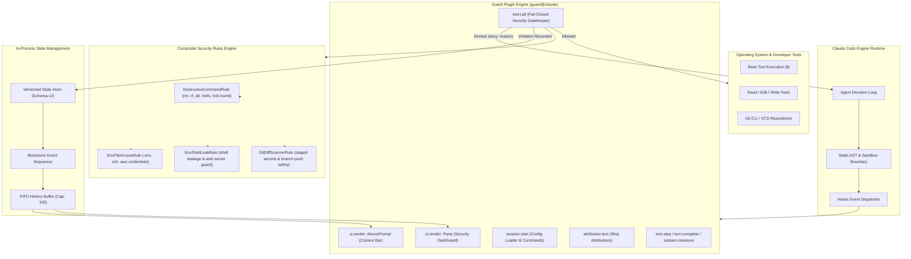

# Guard for Claude Code (`guard@claude`)

[](https://github.com/Nam088/guard/releases/tag/guard--v1.0.0)
[](https://docs.anthropic.com/en/docs/claude-code)
[](https://github.com/Nam088/guard/actions)
[](https://github.com/Nam088/guard/actions)
[](LICENSE)

**Guard** (`guard@claude`) is a production-grade, in-process active security guardrail and multi-surface context monitoring mod for [Claude Code](https://docs.anthropic.com/en/docs/claude-code). 

Engineered with a **Fail-Closed** security architecture, Guard operates directly inside the Claude Code runtime engine via functional hooks. It intercepts destructive shell commands, prevents leakage of environment secrets and SSH/AWS credentials, scans git commits and diffs in real time, monitors context token consumption, and renders responsive status telemetry across terminal and desktop surfaces.

---

## Key Highlights

- **Fail-Closed Security Gatekeeper**: Every gating hook carries an internal `.catch()` safety guarantee. In the event of an unexpected fault, access is denied by default to eliminate bypass vectors.
- **Zero-Process-Fork Overhead**: Built as an in-process Claude Code mod executing in microseconds without external process spawning or subshell latency.
- **Git Commit & Secret Leak Prevention**: Pre-commit and pre-push inspection stops plaintext API keys, tokens, and force-pushes to protected branches (`main`, `master`) before VCS execution.
- **Live Context Telemetry & Forecasting**: Computes token velocity, forecasts turns remaining until auto-compaction `/compact`, monitors 5h/7d rate limit countdowns, and displays quota meters.
- **Interactive UI Toggle & Console**: Provides click-to-toggle protection controls on the `AbovePrompt` status bar and a docked `Pane` dashboard (`/guard-panel`) with clean monochrome typography.
- **Two-Scope Hierarchical Configuration**: Seamless configuration merging from User Global (`~/.guardrc.json`) down to Workspace Project (`.guardrc.json`) with live hot-reloading (`/guard-config reload`).
- **Engine Sandbox Integrity**: 100% compliant with Claude Code engine sandboxing — zero `node:*` built-in imports, zero DOM dependencies, and strictly zero emojis.

---

## Architecture Blueprint



---

## Installation & Setup

### 1. Install via Official Marketplace (Recommended)

Add the marketplace and install `guard@claude`:

```bash
# Add the marketplace repository
claude plugin marketplace add Nam088/guard

# Install the plugin
claude plugin install guard@claude
```

Alternatively, install directly inside an active Claude Code interactive session:

```text
/plugin install guard --marketplace Nam088/guard
```

### 2. Local Development & Worktree Linking

For local testing and contributions:

```bash
git clone https://github.com/Nam088/guard.git
cd guard

# Validate plugin manifest and AST hooks
npm run check

# Link to Claude Code for local execution
claude plugin link .
```

---

## Security Governance & Rules Matrix

Guard enforces four defense-in-depth security layers on every tool call before execution:

| Threat Category | Target Vector | Detection Pattern & Mechanism | Enforcement Action |
| :--- | :--- | :--- | :--- |
| **System Destruction** | `rm -rf /`, `rm -rf ~`, `rm -rf /*` | Regex matching recursive deletions targeting root, user home, or wildcards across all flag orders. | Tool call blocked (`deny`). Incident logged in state. |
| **Raw Block Device Manipulation** | `dd of=/dev/sda`, `dd of=/dev/rdisk0` | Pattern detection of raw drive writes, filesystem formatting (`mkfs`), and shell redirection `> /dev/*`. | Blocked immediately with warning toast. |
| **Process Exhaustion** | Shell fork bombs | AST-level pattern matching for `:(){ :|:& };:`. | Blocked before process spawning. |
| **Secret File Access** | `.env`, `.env.local`, `.env.production` | Path traversal normalization and path suffix verification. Template files (`.env.example`) are automatically whitelisted. | Tool call blocked across `Read`, `Edit`, `Write`, and `Grep`. |
| **Private Credential Theft** | `~/.ssh/id_*`, `~/.aws/credentials` | Absolute and tilde-expanded path matching against known private key and cloud credential paths. | File access blocked; shell references intercepted. |
| **Environment Variable Leakage** | `export`, `printenv`, unauthorized servers | Detects background web servers (`python -m http.server`, `nc -l`) attempting to expose local environment. | Shell execution rejected. |
| **Staged Secret Commits** | `git add .env`, `git add id_rsa` | Inspects arguments of `git add` to prevent secret files from entering the staging index. | Command blocked before git index mutation. |
| **Diff Content Token Exposure** | Staged secrets in `git commit` / diff | Deep regex scanning for AWS keys, GitHub PATs, Anthropic/OpenAI keys, Stripe tokens, and generic credentials. | Commit command denied; leaked line highlighted. |
| **Protected Branch Destruction** | `git push -f origin main` | Parses `git push` target branches and flags (`--force`, `+ref`, `:delete`). Protects `main` and `master`. | Push blocked before network transmission. |
| **Attribution & Identity Leak** | `Co-Authored-By: Claude`, PR link, session URL | Dual-layer suppression: auto-initializes Claude Code native engine settings (`.claude/settings.json`) and hooks `attribution.text` to empty string. | All git commits and pull request descriptions remain 100% clean and unbranded. |

---

## Slash Commands Reference

Guard registers four native slash commands inside Claude Code:

| Command | Usage | Description |
| :--- | :--- | :--- |
| `/guard-panel` | `/guard-panel` | Toggles the docked Security & Context Dashboard pane (`enterprise-guard-monitor-pane`). |
| `/guard-toggle` | `/guard-toggle` | Hot-toggles active protection between `ACTIVE` (fail-closed enforcement) and `PAUSED` (audit pass-through mode). |
| `/guard-config` | `/guard-config`<br>`/guard-config init`<br>`/guard-config reload` | **Default**: Displays current effective configuration and whitelists.<br>**`init`**: Generates a starter `.guardrc.json` and initializes `.claude/settings.json` native attribution suppression.<br>**`reload`**: Hot-reloads configuration files from disk without restarting Claude Code. |
| `/guard-scan` | `/guard-scan` | Manually triggers an in-memory security scan of staged git diffs and commit messages for leaked credentials. |

---

## UI Components & Telemetry

### 1. `AbovePrompt` Context Bar

The context bar sits directly above the interactive prompt and provides real-time telemetry:

```text
[GUARD: OK]  ctx █░░░░░░░░░  12% (185k tokens left)  |  5h: 15% (rst: 2h31m)  |  Claude 3.7 Sonnet
```

- **Interactive Status Badge**:
  - `[GUARD: OK]`: System protected, 0 violations. Clicking toggles protection to paused.
  - `[GUARD: ! 3 BLOCKED]`: Alert badge indicating intercepted violations.
  - `[GUARD: OFF]`: Guard paused. Tool calls pass through in audit-only mode.
- **Context Meter & Compaction Forecasting**: Displays current window percentage, absolute token consumption, and forecasted turn count until auto-compaction (`/compact`).
- **Rate Limit Gauges**: Monitors 5-hour and 7-day token quotas with countdown reset timers (`rst: XhYm`).

### 2. Docked Dashboard Console (`/guard-panel`)

The dashboard console renders an executive security summary with clean, minimalist typography:

```text
┌─ ENTERPRISE SECURITY DASHBOARD ──────────────────────────────────── [ STATUS: ACTIVE ] ─┐
│ Claude Code In-Process Security Mod • v1.0.0                                            │
│                                                                                         │
│ ┌─ THREATS BLOCKED ─┐ ┌─ CONTEXT USAGE ─┐ ┌─ POLICY MODE ─┐ ┌─ SURFACE ───────────────┐ │
│ │ 0                 │ │ 12.4%           │ │ Strict [ON]   │ │ TERMINAL                │ │
│ └───────────────────┘ └─────────────────┘ └───────────────┘ └─────────────────────────┘ │
│                                                                                         │
│ ┌─ Active Governance Policy ──────────────────────────────────────────────────────────┐ │
│ │   - Enforcement Mode   : Strict [ON] | Git Scan [ON]                                │ │
│ │   - Protected Branches : [main, master, production]                                 │ │
│ │   - Custom Whitelists  : 2 files, 4 commands                                        │ │
│ │   - Custom Blocklists  : 0 files, 0 commands                                        │ │
│ └─────────────────────────────────────────────────────────────────────────────────────┘ │
│                                                                                         │
│ ┌─ Recent Security Audit Trail ───────────────────────────────────────────────────────┐ │
│ │ No violations recorded. (Clean audit trail)                                         │ │
│ └─────────────────────────────────────────────────────────────────────────────────────┘ │
│                                                                                         │
│ [ Pause Protection ]   [ Close Dashboard ]    /guard-config | /guard-scan               │
└─────────────────────────────────────────────────────────────────────────────────────────┘
```

---

## Hierarchical Configuration (`.guardrc.json`)

Guard resolves configurations using a 3-tier cascade:

```text
Built-in Defaults  -->  ~/.guardrc.json (User Global)  -->  .guardrc.json (Workspace Project)
```

Generate a starter configuration file in your workspace:

```bash
# Inside Claude Code
/guard-config init
```

### Configuration Options Schema

```json
{
  "$schema": "https://json.schemastore.org/guardrc.json",
  "strict_mode": true,
  "enable_git_scan": true,
  "enable_usage_bar": true,
  "enable_rate_limits": true,
  "notification_mode": "toast",
  "max_stored_violations": 100,
  "protected_branches": ["main", "master", "production", "release"],
  "allowed_patterns": [
    ".env.example",
    ".env.sample",
    ".env.template"
  ],
  "allowed_commands": [
    "npm run build",
    "git status"
  ],
  "custom_blocked_files": [
    "secrets.yaml",
    "private_key.pem"
  ],
  "custom_blocked_commands": [
    "terraform destroy",
    "kubectl delete namespace"
  ],
  "custom_secret_patterns": [
    {
      "name": "Internal Corp API Key",
      "regex": "\\bCORP-[0-9A-Z]{24}\\b"
    }
  ]
}
```

### Options Breakdown

| Key | Type | Default | Description |
| :--- | :--- | :--- | :--- |
| `strict_mode` | `boolean` | `true` | Rejects destructive commands and credential access immediately. When false, acts in audit mode. |
| `enable_git_scan` | `boolean` | `true` | Scans staged git diffs and protects against force-pushes to sensitive branches. |
| `enable_usage_bar` | `boolean` | `true` | Controls rendering of the telemetry bar in the `AbovePrompt` slot. |
| `enable_rate_limits`| `boolean` | `true` | Displays live API rate limits and reset countdown timers. |
| `auto_init_attribution` | `boolean` | `true` | Automatically initializes `.claude/settings.json` native attribution suppression (`commit: ""`, `pr: ""`, `sessionUrl: false`). |
| `notification_mode` | `"toast" \| "silent" \| "modal"` | `"toast"` | Notification mechanism for blocked security actions. |
| `protected_branches`| `string[]` | `["main", "master"]` | List of branches guarded against force-push (`git push -f`) and remote deletion. |
| `allowed_patterns` | `string[]` | `[".env.example", ...]` | Explicit file whitelist to bypass sensitive file access checks. |
| `allowed_commands` | `string[]` | `[]` | Explicit shell command whitelist to bypass destructive command rules. |
| `custom_blocked_files` | `string[]` | `[]` | Additional sensitive file paths to block across read/edit/write tools. |
| `custom_blocked_commands` | `string[]` | `[]` | Additional dangerous shell command patterns to intercept. |
| `custom_secret_patterns` | `Array<{name, regex}>` | `[]` | Custom regex patterns for credential detection in git diffs and commit messages. |

---

## Release Automation & CI/CD

Guard includes automated release tooling to ensure reproducible, high-integrity releases:

```bash
# Automated semantic patch release (e.g. 1.0.0 -> 1.0.1)
npm run release

# Or specify bump type:
npm run release:patch
npm run release:minor
npm run release:major
```

### Automated Release Pipeline Workflow

1. **Version Synchronization**: Bumps version simultaneously in `package.json`, `.claude-plugin/plugin.json`, and `.claude-plugin/marketplace.json`.
2. **Quality Verification Gate**: Runs TypeScript compilation (`tsc --noEmit`), strict plugin validation (`claude plugin validate ./ --strict`), 108 unit tests, and the bundle builder (`esbuild`).
3. **Artifact Packaging**: Builds clean distribution tarball `guard-<version>.tgz`.
4. **Git Tagging**: Generates standard Git tag (`v<version>`) and engine manifest tag (`guard--v<version>`) using `claude plugin tag`.
5. **GitHub Release**: GitHub Actions automatically computes SHA-256 checksums and creates the GitHub Release with attached assets.

---

## Quality Assurance & Verification

Guard is validated against Claude Code engine requirements with 100% test pass rates:

```bash
# Run TypeScript type check
npm run typecheck

# Run strict engine validation (AST, sandbox boundaries, manifest)
npm run validate

# Run comprehensive unit test suite
npm run test

# Build standalone distribution bundle
npm run build

# Run entire QA verification suite
npm run check
```

---

## Compliance & Security Standards

- **Strict No-Emoji Standard**: All UI components, terminal text, audit logs, and documentation strictly adhere to zero-emoji enterprise guidelines.
- **Engine Sandbox Integrity**: Hook modules import strictly via relative paths and `"claude-code"`. Zero dependencies on Node.js built-ins (`node:fs`, `node:child_process`, `node:os`, `node:path`) inside runtime hooks.
- **Fail-Closed by Design**: Tool call gating hooks wrap handlers in `.catch()` fallbacks that reject execution if an unexpected fault occurs.

---

## Contributing

We welcome community contributions, bug reports, and new security rule proposals!

Please read our [Contributing Guide](CONTRIBUTING.md) for details on development setup, architectural guidelines, coding conventions, and pull request procedures.

To report a bug or request a new security rule:
- [Submit a Bug Report](https://github.com/Nam088/guard/issues/new?template=bug_report.md)
- [Propose a Security Rule](https://github.com/Nam088/guard/issues/new?template=security_rule_request.md)

---

## License

This project is licensed under the [MIT License](LICENSE).
